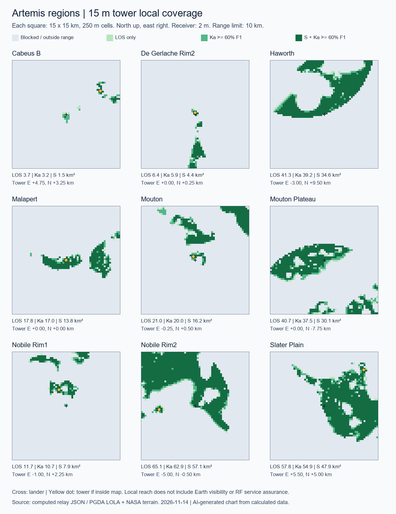

# Card 13 — relay towers across the 33-site catalogue

Owner: Jiyong. Computation date: 2026-11-14. Status: computation complete; independent checks passed.

This analysis compares geometric direct-to-Earth visibility with a fixed-height single tower
and a greedy network of up to three towers. It does not guarantee a radio service, an available
Earth station, or the structural feasibility of a tower.

## Method and changes

- Real 2026–2030 MOON_ME ephemeris: 43,824 hourly samples; the lander antenna is 2 m above terrain.
- Per site: 5,025 candidate positions on a 250 m lattice within 10 km; heights 5, 15, 30 and 50 m.
- Tower horizons: 720 bins at 0.5°, marching 5 m to 300 km on 8,001 logarithmic distances with lunar curvature.
- Local paths: interior samples at most 5 m apart; first-Fresnel clearance for S=2.2 GHz and Ka=26 GHz.
- Link availability does not require concurrent tower sunlight or a battery model. Tower sunlit fraction and longest darkness are reported separately, so a 100% geometric link is not a claim of uninterrupted powered service.
- The default link rule remains geometric LOS. Fresnel clearance is reported separately; geometric link fractions do not enforce the 60% Fresnel rule unless that rule is explicitly selected.
- Candidate slope is a 250 m plane fit, screened at 15°. Sunlight uses the existing solar-disk definition.
- Corrected off-centre DEM selection, removed the arbitrary high-Earth clear-sky shortcut, rejected missing terrain, and invalidated resumes when terrain file identity or ephemeris content changes.
- Optional height curves and 15×15 km Artemis coverage grids preserve existing contract fields. See [contract section 12](data_contract.md#121-optional-card-13-additions-2026-11-14-jiyong).
- Network records now retain clearance to the actual parent tower in addition to the existing lander-path fields.

## Results

All 33 sites have real-terrain relay results; the index has no pending terrain. All nine Artemis regions include four-height coverage grids.

### Height curves

Each column is geometric lander link availability. Different heights may select different towers.

| Site | Direct % | 5 m % | 15 m % | 30 m % | 50 m % | 15 m network % | 15 m network outage h |
| --- | --- | --- | --- | --- | --- | --- | --- |
| APOLLO11 | 100.00 | 100.00 | 100.00 | 100.00 | 100.00 | 100.00 | 0 |
| APOLLO12 | 100.00 | 100.00 | 100.00 | 100.00 | 100.00 | 100.00 | 0 |
| APOLLO14 | 100.00 | 100.00 | 100.00 | 100.00 | 100.00 | 100.00 | 0 |
| APOLLO15 | 100.00 | 100.00 | 100.00 | 100.00 | 100.00 | 100.00 | 0 |
| APOLLO16 | 100.00 | 100.00 | 100.00 | 100.00 | 100.00 | 100.00 | 0 |
| APOLLO17 | 100.00 | 100.00 | 100.00 | 100.00 | 100.00 | 100.00 | 0 |
| LUNA16 | 100.00 | 100.00 | 100.00 | 100.00 | 100.00 | 100.00 | 0 |
| LUNA20 | 100.00 | 100.00 | 100.00 | 100.00 | 100.00 | 100.00 | 0 |
| LUNA24 | 100.00 | 100.00 | 100.00 | 100.00 | 100.00 | 100.00 | 0 |
| CHANGE3 | 100.00 | 100.00 | 100.00 | 100.00 | 100.00 | 100.00 | 0 |
| CHANGE4 | 0.00 | 0.00 | 0.00 | 0.00 | 0.00 | 0.00 | 43824 |
| CHANGE5 | 100.00 | 100.00 | 100.00 | 100.00 | 100.00 | 100.00 | 0 |
| CHANGE6 | 0.00 | 0.00 | 0.00 | 0.00 | 0.00 | 0.00 | 43824 |
| CHANDRAYAAN3 | 100.00 | 100.00 | 100.00 | 100.00 | 100.00 | 100.00 | 0 |
| SLIM | 100.00 | 100.00 | 100.00 | 100.00 | 100.00 | 100.00 | 0 |
| IM1 | 100.00 | 100.00 | 100.00 | 100.00 | 100.00 | 100.00 | 0 |
| IM2 | 81.42 | 100.00 | 100.00 | 100.00 | 100.00 | 100.00 | 0 |
| BLUE_GHOST1 | 100.00 | 100.00 | 100.00 | 100.00 | 100.00 | 100.00 | 0 |
| ARTEMIS_CABEUS_B | 29.64 | 76.11 | 85.73 | 88.71 | 89.52 | 89.67 | 124 |
| ARTEMIS_HAWORTH | 58.54 | 75.08 | 75.22 | 75.43 | 75.68 | 75.44 | 199 |
| ARTEMIS_MALAPERT | 100.00 | 100.00 | 100.00 | 100.00 | 100.00 | 100.00 | 0 |
| ARTEMIS_MOUTON_PLATEAU | 58.37 | 83.18 | 83.44 | 83.87 | 84.33 | 83.70 | 130 |
| ARTEMIS_MOUTON | 59.78 | 86.69 | 94.21 | 94.55 | 94.90 | 96.62 | 90 |
| ARTEMIS_NOBILE_RIM1 | 67.98 | 77.37 | 80.74 | 83.92 | 85.93 | 100.00 | 0 |
| ARTEMIS_NOBILE_RIM2 | 77.01 | 78.39 | 78.45 | 78.50 | 78.57 | 78.75 | 186 |
| ARTEMIS_DE_GERLACHE_RIM2 | 55.27 | 57.69 | 57.72 | 57.79 | 57.87 | 59.09 | 291 |
| ARTEMIS_SLATER_PLAIN | 39.77 | 46.14 | 46.20 | 46.28 | 46.40 | 47.17 | 379 |
| SHACKLETON_RIM | 49.94 | 54.39 | 54.41 | 54.46 | 54.49 | 54.58 | 321 |
| CONNECTING_RIDGE | 43.89 | 52.92 | 54.20 | 54.25 | 54.29 | 55.39 | 321 |
| PEAK_NEAR_SHACKLETON | 55.32 | 56.64 | 56.67 | 56.71 | 56.75 | 56.98 | 322 |
| DE_GERLACHE_RIM1 | 57.20 | 57.26 | 57.34 | 57.40 | 57.48 | 59.01 | 291 |
| SHOEMAKER_RIM_A | 43.45 | 45.14 | 45.16 | 45.21 | 45.30 | 50.27 | 368 |
| IM3_REINER_GAMMA | 100.00 | 100.00 | 100.00 | 100.00 | 100.00 | 100.00 | 0 |

### 15 m coverage and tower power context

Each map represents a 225 km² square. Local reach and Earth visibility are separate.

| Region | Local LOS km² | S F1≥60% km² | Ka F1≥60% km² | Tower Earth % | Tower sunlit % | Tower longest dark h |
| --- | --- | --- | --- | --- | --- | --- |
| ARTEMIS_CABEUS_B | 3.69 | 1.50 | 3.19 | 85.73 | 65.69 | 294 |
| ARTEMIS_HAWORTH | 41.31 | 34.56 | 39.19 | 75.22 | 42.78 | 561 |
| ARTEMIS_MALAPERT | 17.81 | 13.81 | 17.00 | 100.00 | 45.69 | 401 |
| ARTEMIS_MOUTON_PLATEAU | 40.69 | 30.12 | 37.50 | 83.44 | 53.92 | 381 |
| ARTEMIS_MOUTON | 21.00 | 16.19 | 20.00 | 94.21 | 66.09 | 301 |
| ARTEMIS_NOBILE_RIM1 | 11.69 | 7.94 | 10.69 | 80.74 | 70.03 | 292 |
| ARTEMIS_NOBILE_RIM2 | 65.06 | 57.12 | 62.88 | 78.28 | 49.91 | 393 |
| ARTEMIS_DE_GERLACHE_RIM2 | 6.44 | 4.38 | 5.88 | 57.72 | 72.87 | 330 |
| ARTEMIS_SLATER_PLAIN | 57.81 | 47.88 | 54.88 | 46.20 | 59.62 | 352 |



Map source hashes: [coverage provenance](card13_coverage_provenance.json).

### Fixed-location resolution sensitivity

| Site | Tower height m | 80 m DEM link % | 240 m DEM link % | 240−80 %p | Fixed east/north m |
| --- | --- | --- | --- | --- | --- |
| ARTEMIS_DE_GERLACHE_RIM2 | 5 | 57.70 | 55.17 | -2.5283 | (0, 250) |
| ARTEMIS_DE_GERLACHE_RIM2 | 15 | 57.73 | 57.70 | -0.0274 | (0, 250) |
| ARTEMIS_DE_GERLACHE_RIM2 | 30 | 57.79 | 57.75 | -0.0365 | (0, 250) |
| ARTEMIS_DE_GERLACHE_RIM2 | 50 | 57.87 | 57.84 | -0.0365 | (0, 250) |
| SHACKLETON_RIM | 5 | 54.38 | 41.87 | -12.5114 | (7250, 5500) |
| SHACKLETON_RIM | 15 | 54.40 | 54.20 | -0.2008 | (7250, 5750) |
| SHACKLETON_RIM | 30 | 54.45 | 54.26 | -0.1962 | (7500, 5750) |
| SHACKLETON_RIM | 50 | 54.48 | 54.29 | -0.1962 | (7500, 5750) |
| CONNECTING_RIDGE | 5 | 54.06 | 54.05 | -0.0160 | (0, -250) |
| CONNECTING_RIDGE | 15 | 54.20 | 54.19 | -0.0114 | (0, 750) |
| CONNECTING_RIDGE | 30 | 54.25 | 54.25 | +0.0000 | (250, 750) |
| CONNECTING_RIDGE | 50 | 54.29 | 54.28 | -0.0046 | (250, 750) |

### Independent results

| Site | Max full-window difference %p | 30-epoch mismatches D/T/link | 1 m LOS minus production | Result | Seconds |
| --- | --- | --- | --- | --- | --- |
| APOLLO11 | 0.000000 | 0/0/0 | same-position; auxiliary path checked | PASS | 9.94 |
| APOLLO17 | 0.000000 | 0/0/0 | same-position; auxiliary path checked | PASS | 9.92 |
| IM2 | 0.001139 | 0/0/0 | -0.1532 m | PASS | 10.41 |

### Runtime

| Measure | Observed value |
| --- | --- |
| CPU / parallelism | AMD Ryzen 5 5600X; 4 active site jobs; BelowNormal; BLAS/OMP/Numba threads=1 |
| Download wall time | 1284.4 s (overlapped computation) |
| 33-site compute wall time including finalization | 6321.3 s |
| Final re-finalization using saved visibility | 219.7 s |
| Independent three-site verification | 30.27 s |
| Three-site sensitivity | 4.60 s |

Evidence: [independent results](card13_independent.json), [resolution sensitivity](card13_sensitivity.json), [runtime](card13_runtime.json).

## Resolution sensitivity

The 80 m and 240 m cases replace only terrain within 3 km of the lander. The selected single
tower positions remain fixed and the far field remains unchanged. Each antenna stays its stated
height above the variant terrain. This isolates resolution effects; it does not rerank candidates
or re-optimise a network. Differences are sensitivity measurements, not errors against ground truth.
No adjustment forces the coarse and fine DEMs to agree.

In these three sites, 15–50 m towers change by at most 0.201 percentage points between the 80 m and 240 m near-field variants. The **5 m tower height** case is more sensitive: Shackleton changes by -12.511 percentage points and De Gerlache Rim2 by -2.528. For Shackleton, the sampled lander elevation changes by -15.495 m; the fixed 5 m tower path clearance changes from +1.476 m to -0.179 m, so the path becomes blocked, while direct Earth visibility also decreases. These are different terrain inputs, not failures of the independent same-input 1%p implementation check. The 5 m here denotes antenna height, not DEM resolution.

## Independent verification

The verifier imports no production geometry. It uses PROJ geodesics and independent 3D rays,
reads the original DEMs, and checks IM2, Apollo 17 and Apollo 11 at 15 m. It compares the entire
window using the same distance sampling and separately traces 30 reproducible hourly epochs
with an additional 2.5 m radial grid. Local LOS/Fresnel paths are sampled at 1 m. Same-position
best towers are explicitly degenerate; a non-coincident candidate is checked as well.

The criterion is ≤1 percentage point for matching fractions and no more than 1% mismatched
states in the 30 samples (therefore zero mismatches for 30 samples). Thirty samples alone cannot
establish a statistical 1% error bound. This is implementation and sampling verification against
the same DEMs, not verification of the Moon's true terrain. Passing three sites does not establish a universal 1%p truth-error bound for the entire catalogue.

## Shackleton coordinate handoff

The new point uses freshly centered windows at all six polar resolutions. Its DEM height is 1729.62 m above the 1737.4 km reference sphere. A 4×4 km, 250 m grid inspection contains 289 finite samples; the center is the highest sampled point in that grid (not a claim of a surveyed summit). The profiles are recorded in [terrain inspection](card13_shackleton_terrain.json). The regenerated core.js metrics are sunlight 84.825666%, Earth visibility 49.942954%, both 44.361537%, and longest sampled darkness 75 h for 2026–2030.

## Final checks

- `python -m pytest pipeline -q`: 106 passed in 19.77 s; six upstream deprecation warnings.
- `python pipeline/check_contract.py`: 0 errors, 0 warnings; 33 relay records, 0 pending terrain.
- `node pipeline/test_metrics.mjs`: actual JS/Python metrics agree on three synthetic fixtures and all 33 real sites, including the new Shackleton point.
- All reported independent/sensitivity input hashes and all nine plotted coverage source hashes match the final JSON files.

## Reproduce

```powershell
$env:OPENBLAS_NUM_THREADS='1'; $env:OMP_NUM_THREADS='1'; $env:NUMBA_NUM_THREADS='1'
python pipeline/fetch_global.py --skip-global --workers 2
python pipeline/run_relay.py --jobs 4
python pipeline/card13_relay.py --output docs/card13_sensitivity.json
python pipeline/verify_card13_relay.py --output docs/card13_independent.json
python pipeline/check_contract.py
python -m pytest -q
```

Use the existing `.venv\Scripts\python.exe` if Python packages are not installed globally.
The run resumes per candidate; raw data and checkpoints remain git-ignored. For a full test run,
the existing ephemeris generation workflow must also supply `data/processed/ephem_2020-2038_2h.npz`.

## Sources and limits

- [PGDA LOLA terrain](https://pgda.gsfc.nasa.gov/products/90), [SLDEM2015](https://pds-geosciences.wustl.edu/lro/lro-l-lola-3-rdr-v1/lrolol_1xxx/data/sldem2015/tiles/float_img/), and [LOLA global grids](https://pds-geosciences.wustl.edu/lro/lro-l-lola-3-rdr-v1/lrolol_1xxx/data/lola_gdr/cylindrical/float_img/). Exact available resolutions are retained in each result's `dem_sources`.
- [NAIF kernels](https://naif.jpl.nasa.gov/pub/naif/generic_kernels/) and the repository's existing ephemeris provenance.
- [NASA BEACON concept](https://ntrs.nasa.gov/citations/20240014584) motivates the 15 m / approximately 10 km scenario. Other heights, frequency and budget parameters are modelling choices, not BEACON specifications.
- Terrain inside the 5 m horizon cutoff and features missed by the 0.5° azimuth sampling are not resolved by this model.
- DEM resolution is not a promise of vertical accuracy. A 5 m path sampling interval does not create 5 m terrain where only a coarser DEM exists.
- Coverage areas count 250 m cells in a local map; they are approximate represented areas and not precise terrain surface areas.
- Greedy selection can miss a zero-immediate-gain bridge and is not a proof of optimality. Construction, RF interference, terrain below DEM resolution, and Earth-station schedules are outside this calculation.
- This PR is stacked on Card 15 PR #16 (648adfd). SHACKLETON_RIM uses -89.6866°, -162.81° (east-positive), the first Shackleton S row of Gläser et al. Table 2: https://ntrs.nasa.gov/api/citations/20170007365/downloads/20170007365.pdf . Horizon, relay and core.js metrics are recomputed at that point. The paper's exact alignment with MOON_ME (DE421) is unverified; its 20-year illumination percentage is not a target for these different dates/definitions. Merge #16 before #14, then Card 16 must refresh named-site/Korea validation. Historical Card 8/9/10 reports describe their original coordinates.

## Review rulings

The independent code review found one Important co-located-path bug; a three-latitude regression reproduced it before the fix and passes afterward. Final artifact review at d477409 passed with no remaining Critical, Important or Minor finding. The reviewer checked 33 coordinate/timeline/outage records, 59 parent hops, nine maps and all evidence hashes, and independently reran the contract checker and 36 related tests. No deferred minors remain. Physical terrain truth, RF service and structural feasibility are outside this geometric calculation; treating outputs as flight or construction assurance would exceed the evidence. Greedy network optimality and sensitivity re-ranking are not claimed, so better configurations may exist. Resume provenance uses raster size/mtime and global-label hashes plus ephemeris content hashes; it does not authenticate every DEM byte, so a deliberately same-size/same-timestamp replacement could evade that guard.

## Integration handoff

- Integrator: merge coordinate PR #16 before this PR #14 (stacked dependency); retain the corrected catalogue and matching regenerated products.
- Card 16 owner: rerun named-horizon/PGDA and Korea window checks for the new Shackleton coordinate; old validation rows are historical evidence, not validation of this point.
- UI owner: existing relay fields remain compatible. New coverage masks are optional section-12 data, with a static nine-region preview in this report; live UI wiring is an integrator task.
- Human reviewers: complete the source-audit and SI log TO CHECK cells.

Review also retained the explicit unverified Shackleton datum/human-source status: precise location assurance requires those checks. Card 16 verification and live UI coverage wiring remain assigned handoffs, so this PR does not claim their completion. Using the coordinate change on a stacked feature branch lets Card 13 finish without modifying main; a later change to PR #16 requires regenerating this site before integration.
