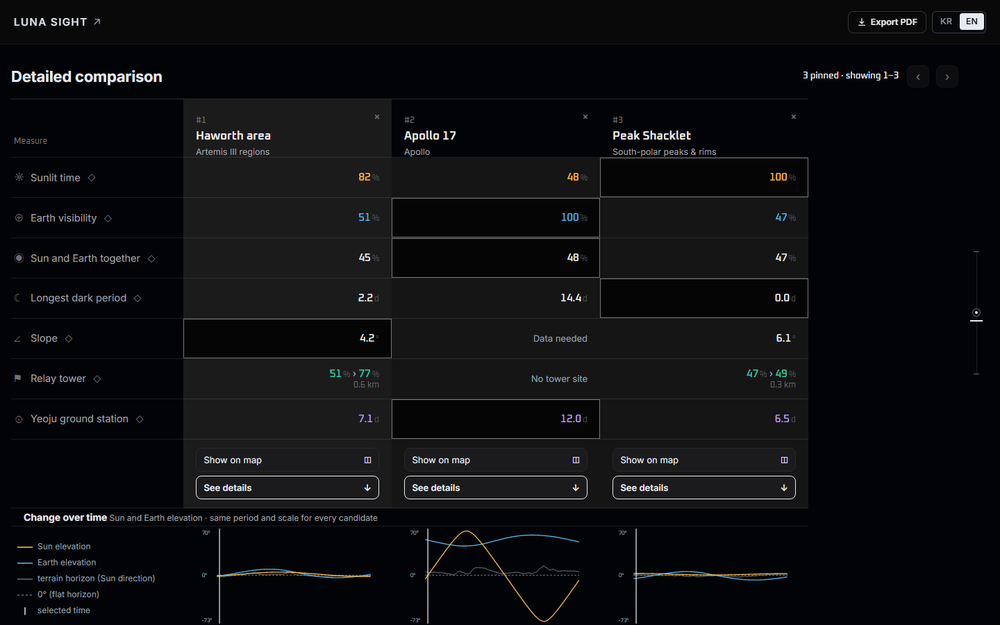

# Bundles 6/9 — comparison and lower-page shell

Owner: Jiyong. Source base: 01894e9. Reference: the 16:37 designer comparison frame and the superseding rules in `../채이사본_동기화_전수_1555.md`.
The user reassigned the intro to another owner; intro and About rocket motion are not part of this PR.

## Frame comparison (1440 × 900)

Reference images describe appearance only. Contest values, names and missing-data states come from repository data, not the practice screenshots. No practice source code was copied.

| Designer reference | Implemented contest UI |
|---|---|
|  |  |

At 1100 px the candidate columns shrink within the 150–300 px range. The table is 1,148 px wide at 1440: a 248 px measure column and three 300 px candidate columns. Seven measure rows, two actions per candidate and equal-scale elevation charts share the same columns. The timeline remains directly below the table. Dark and Yeoju durations use days with one decimal. Missing catalogue landing slopes are explicitly `Data needed` (Apollo 17); relay-box slopes are not substituted.

Highlights indicate a unique best available raw value; exact ties and relay rows have no winner. They are not overall site rankings. Landing-slope footprints/resolutions vary, as explained by the row popover. Relay distances retain the production network's nearest-tower definition. Source scientific calculations are unchanged.

The lower pages use #020306 and the scrolled header border is rgb(21,22,25). Section headings remain below the fixed header. The step rail has 88 px spacing, a 176 px spine, a current marker/bar, and labels revealed by scrolling for 1.8 s, hover or keyboard focus. Plain-wheel page scrolling and Ctrl/Cmd-wheel globe zoom were already implemented and are retained.

## Verification

`python pipeline/verify_design_6_9.py http://127.0.0.1:8020`

The test uses Chromium, real repository data and the real app. It checks 1920/1440/1280/1100/390 px, EN/KO, shared chart axes, missing slope, no relay winner, chart keyboard readings, lane-specific timeline relay/KDSA readings, map/details navigation, contiguous numbering after removal, page overflow, tie highlighting, rail auto-hide/focus reveal and info-popover dismissal. Results: `checks.json`. Screenshots for all five widths and both languages are alongside this file. Reduced-motion is used for the viewport/action checks; rail timing is additionally exercised without reduced-motion.

The reference frame uses practice values and a logo image. Those intentionally differ: the contest uses its own data and the text wordmark. Long catalogue names are shown in their catalogue short form with the full name in a title. At 390 px the existing stacked page layout is retained and the comparison table scrolls internally; the document itself does not overflow.

## Windows preview

On this machine `python -m http.server` serves `.js` as `text/plain` because of the host MIME registry, preventing module startup. Use a static server with `.js`/`.mjs` explicitly mapped to `text/javascript`. This is a preview-host issue, not a change to application delivery.

```python
from http.server import ThreadingHTTPServer, SimpleHTTPRequestHandler
SimpleHTTPRequestHandler.extensions_map.update({'.js': 'text/javascript', '.mjs': 'text/javascript'})
# Run from web/; open http://127.0.0.1:8020/
ThreadingHTTPServer(('127.0.0.1', 8020), SimpleHTTPRequestHandler).serve_forever()
```

## Scope

Files: `web/js/compare_view.js`, `web/js/shell.js`, `web/css/layout.css`, browser verification and evidence. No changes to `web/index.html`, data, science engines, intro or Site check's internal analysis cards. The legacy All-sites expandable table is hidden on screen so the comparison flows directly into Site check; its computation mount remains intact.

## Review follow-up

Fresh review found and resolved responsive column sizing at 1100 px and lane-specific timeline readings. A follow-up guard hides readings when terrain is pending and treats absent relay segments as missing data; the targeted browser check is recorded in `pending_check.json`.
