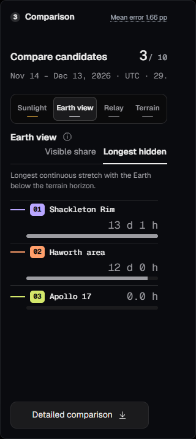
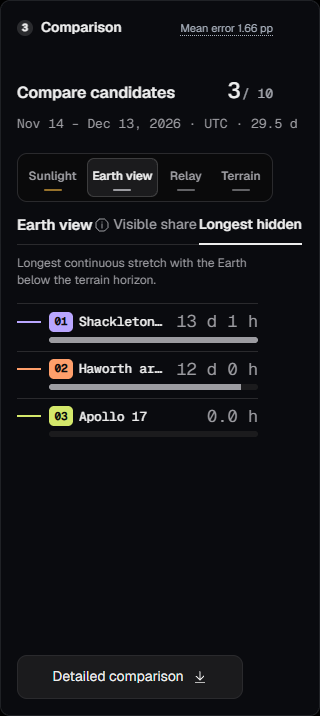
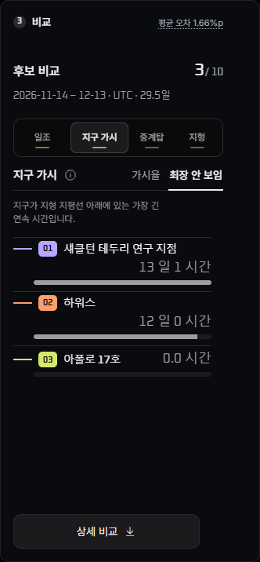
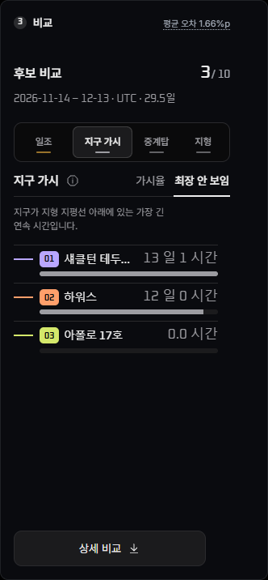

# v46 narrow tray and collapsed dock regressions

Baseline main: 758c15eec324c6428a90f888c4b21a9ab128b7e0 (version 46).

## Change

Only production file changed: web/css/layout.css (25 added lines). Narrow tray rules are restricted to 1100–1439 px; English headings keep 14px labels and reuse right-hand padding without clipping. Candidate bar rows use explicit grid columns: swatch / chip / shrinkable name / full time value. Bars and data notes retain their own rows. Full names remain available through existing title attributes. At 1600px and wider only, the collapsed dock uses its content width and removes the hidden time block from sizing. Normal 1920 dock dimensions stay 800×52. No calculations, data, index markup or minimap code changed.

The earlier PR #117 1280 English rules are already present in v46; this patch extends coverage to 1100 and overrides the older narrow declarations.

## Validation

Chrome + Playwright, 1920×1080 / 1440×900 / 1280×800 / 1100×800, EN/KR, before and after. Each configuration checks all eight category/sub-tab states, normal dock and Earth-layer collapsed dock. **16 configurations, 128 category/sub-tab states, zero failures, zero console/page errors, zero failed requests, zero document/internal horizontal overflow.** Formatted time values are unchanged. Narrow English sub-tabs remain 14px, inline and inside every clipping ancestor. Long Sun/Earth duration values stay on the name line; all affected rows are 47.34375px after the fix.

| Check | Before | After |
|---|---|---|
| 1100 EN Sun/Earth sub-tabs | Wrap below heading | Inline at 14px |
| Narrow EN/KR long duration rows | Some 69.34375px | All 47.34375px |
| 1920 EN/KR collapsed Earth dock | 800×52 | 286×52 |
| 1440 EN/KR | Baseline | Identical bounds, full-tray PNG bytes, values and collapsed dock |

### 1440 full-tray PNG SHA-256 (before = after)

- EN: 5f55048d35f7a2839e24ed17e990ffd7a975db287800992e7b7c1fb0d7995ecd
- KO: 476478253b21986c4195371b80b30a8a41e3f9c1ac545b0348854563dfd77350

## Before / after

### 1100 EN: inline Earth heading and long values

### 1280 KR: long values

### 1920 collapsed Earth dock

All EN/KR PNGs are in this directory. summary.json contains bounds and original formatted values; checks.json.gz preserves the complete DOM observations. result.json contains all failures (empty).

## Reproduction

From the repository root, with Node and Chrome installed:

    npm install --prefix verification/v46_tray_dock --no-save playwright
    pwsh -File verification/v46_tray_dock/prepare-cache.ps1
    $env:QA_CACHE = (Resolve-Path verification/v46_tray_dock/.cache).Path
    node verification/v46_tray_dock/check.cjs

If CDN requests work normally, omit cache preparation and QA_CACHE. On other platforms set CHROME_PATH to the Chromium/Chrome executable. QA_OUT and REPO_ROOT optionally override paths. The verifier pins the baseline stylesheet using git show; it never patches production files.

The managed browser initially blocked CDNs. For this run, original Google Fonts CSS/font binaries, Pretendard v1.3.9 subsets and Three.js 0.170.0 were downloaded unchanged and supplied through request interception. Actual font faces were confirmed loaded and Three.js executed; data and component implementations were not mocked. Sources: https://fonts.googleapis.com/ ; https://cdn.jsdelivr.net/gh/orioncactus/pretendard@v1.3.9/ ; https://cdnjs.cloudflare.com/ajax/libs/three.js/0.170.0/three.module.min.js . Vendor files are not committed. The portable verifier preserves the tested assertions, with configurable paths added.

## Integration note

The existing 1280 English follow-up media block has no explicit closing brace before later minimap rules. New independent media rules are inserted before it, with enough specificity to override its narrow declarations. Existing later rule scopes are deliberately preserved so this patch does not alter 1440 or minimap behavior. Closing/re-scoping the unrelated block is outside this request.
